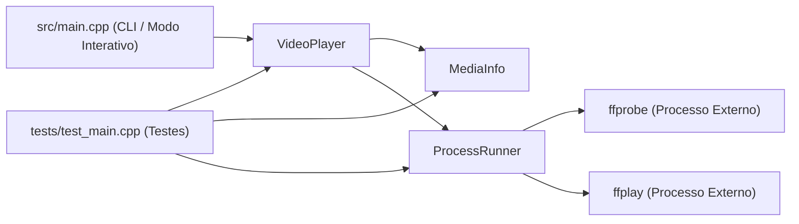

# Arquitetura Técnica (`docs/ARCHITECTURE.md`)

Este documento descreve a organização modular, o fluxo de dados e as decisões de engenharia adotadas no **cpp-ffmpeg-player**.

---

## Visão Geral dos Módulos

O projeto é dividido em uma biblioteca estática reutilizável (`ffmpeg_player_core`), um executável de linha de comando (`cpp-ffmpeg-player`) e um executável de testes (`test_runner`).

---

## Componentes Principais

### 1. `ProcessRunner` (`include/ffmpeg_player/ProcessRunner.hpp`)
Encapsula toda a interação com o sistema operacional e o shell:
- **`escapeShellArg`**: Garante que caminhos de arquivo contendo espaços, aspas ou caracteres especiais sejam escapados com segurança antes de compor a string de comando (aspas simples escapadas no POSIX e aspas duplas no Windows), eliminando falhas com caminhos compostos e vulnerabilidades de injeção de comando.
- **`capture`**: Executa processos não interativos (`ffprobe`) utilizando `popen` / `_popen`, lê o `stdout` em buffer seguro (`std::array`) e normaliza o código de saída (`WEXITSTATUS`).
- **`execute`**: Executa processos interativos (`ffplay`) via `std::system` e retorna o status de saída normalizado.

### 2. `MediaInfo` (`include/ffmpeg_player/MediaInfo.hpp`)
Estrutura de dados e *parser* desacoplado de I/O:
- **`parseFfprobeOutput`**: Analisa a saída estruturada de `ffprobe -v error -show_format -show_streams` (blocos `[STREAM]...[/STREAM]` e `[FORMAT]...[/FORMAT]`).
- **`parseFrameRateFraction`**: Converte frações nativas do FFmpeg (como `30/1` ou `30000/1001`) em valores `double` precisos.
- **Formatadores (`toPrettyString`, `toJsonString`, `formatDuration`, `formatFileSize`)**: Permitem apresentar os mesmos metadados tanto em relatórios visuais para humanos quanto em formato JSON estruturado para integração com scripts e pipelines.

### 3. `VideoPlayer` (`include/ffmpeg_player/VideoPlayer.hpp`)
Fachada de alto nível e tratamento de erros:
- **Validação prévia com `std::filesystem`**: Verifica se o caminho informado existe e é um arquivo regular antes de invocar o `ffprobe` ou `ffplay`, lançando `FileNotFoundException` com mensagem clara.
- **Hierarquia de Exceções**:
  - `MediaException` (base derivada de `std::runtime_error`)
  - `FileNotFoundException` (arquivo inexistente ou inválido)
  - `PlaybackException` (falha na reprodução via `ffplay`)
- **`PlaybackOptions`**: Permite configurar tela cheia (`-fs`), remoção de áudio (`-an`), remoção de vídeo (`-vn`), auto-fechamento (`-autoexit`), repetições (`-loop`) e título da janela (`-window_title`).
